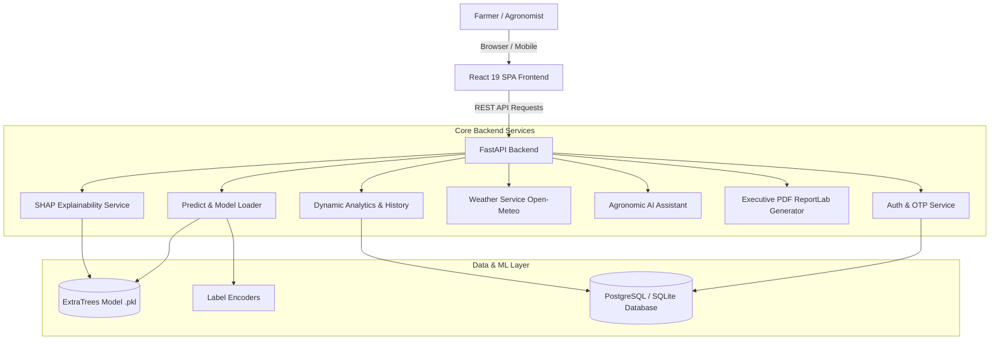

# 🌾 AgriShield AI — Predictive Pest Outbreak Intelligence System

[](https://www.python.org/)
[](https://fastapi.tiangolo.com/)
[](https://react.dev/)
[](https://scikit-learn.org/)
[](https://opensource.org/licenses/MIT)

**AgriShield AI** is an end-to-end, precision agricultural intelligence platform designed to predict and prevent crop pest outbreaks before they inflict irreversible damage. By analyzing real-time meteorological signals (Temperature, Humidity, Rainfall, Wind Speed, Sunshine, Evaporation) alongside multi-season field observation datasets, AgriShield AI delivers actionable pest pressure forecasts, explainable SHAP risk attributions, and customized Integrated Pest Management (IPM) treatment plans for **Cotton** and **Rice (Paddy)** growers.

---

## 🌟 Key Features

- **🔬 Predictive Pest Outbreak Engine**:
  Trained on multi-season historical field datasets, our optimized **ExtraTrees Regressor** generates pest pressure values and categorizes outbreaks into **Low**, **Medium**, or **High** risk levels.
- **🔍 Explainable AI (SHAP TreeExplainer)**:
  Every prediction is paired with real-time SHAP (SHapley Additive exPlanations) feature attributions, showing farmers exactly how each weather parameter (e.g. morning humidity spike, temperature range) contributed to the risk score.
- **⛅ Live Weather Assist (Open-Meteo Integration)**:
  Auto-detects GPS coordinates or place names and auto-populates exact current meteorological conditions into the prediction pipeline.
- **🤖 Agronomic AI Assistant**:
  A specialized agricultural advisor providing IPM protocols, biological alternatives (*Bacillus thuringiensis*, *Trichogramma* egg cards, Neem oil 2%), chemical dosages, and pest identification guides. Optional Gemini API integration available.
- **📋 Targeted Treatment & Yield Impact Plans**:
  Pest-specific actionable recommendations outlining urgency level, preventive steps, organic options, recommended pesticides, and estimated potential yield losses.
- **📄 Executive PDF Reports**:
  Generates branded, publication-ready PDF reports with ReportLab, including risk badges, field parameters, weather conditions, and IPM checklists for field workers and agronomists.
- **📊 Real-time Outbreak Analytics**:
  Interactive timeline charts, risk distribution breakdown, crop vulnerability comparisons, and geographic heat maps powered by Recharts.
- **🔐 Secure Authentication & History**:
  JWT token-based authentication with Email OTP verification, account management, and CSV data exports.

---

## 🏗️ System Architecture



---

## 🔬 Machine Learning Pipeline

1. **Dataset Integration**:
   - Master dataset merged from multi-season **Cotton** (`Book2.csv`) and **Rice** (`RICE.csv`) observation records (24,846 samples).
2. **Feature Engineering**:
   - `Temp_Diff` = `MaxT` - `MinT`
   - `Avg_Humidity` = (`RH1` + `RH2`) / 2
   - `Week_Sin` & `Week_Cos` = Cyclic encoding for 52 standard calendar weeks
   - `Weather_Index` = `MaxT` + `RH1` + `RH2` + `RF` + `WS`
   - `Rainfall_Category` = Discretized into `Low` (<=10mm), `Medium` (10-50mm), `High` (>50mm)
3. **Target Quality Controls**:
   - Outliers clipped at the 99th percentile and log-transformed (`clip_to_p99_log1p`) to stabilize high right-skewed pest values.
4. **Validation Strategy**:
   - Time-aware temporal holdout split based on observation years to prevent future-data leakage into training.
5. **Model Architecture**:
   - **ExtraTrees Regressor** (250 estimators, log1p objective) achieving superior generalization and stability across unseen seasons.

---

## 💻 Tech Stack

| Domain | Technologies Used |
| :--- | :--- |
| **Frontend** | React 19, Vite, Tailwind CSS, Lucide React, Recharts, Framer Motion, Axios, React Hook Form |
| **Backend** | FastAPI, Uvicorn, SQLAlchemy, Pydantic, Python-Jose (JWT), ReportLab, Passlib (Bcrypt) |
| **Machine Learning** | Scikit-Learn (ExtraTrees, Random Forest), SHAP, Pandas, NumPy, Joblib |
| **Database** | PostgreSQL 16 (Production) / SQLite3 (Zero-setup Local Fallback) |
| **External APIs** | Open-Meteo Geocoding & Weather Forecast API, Google Gemini API (Optional) |
| **DevOps** | Docker, Docker Compose, Nginx |

---

## 🚀 Getting Started

### Prerequisites
- **Python 3.12+**
- **Node.js 20+** and **npm**
- *(Optional)* **Docker & Docker Compose**

---

### Local Development Setup

#### 1. Clone the Repository
```bash
git clone https://github.com/Pandeeswaran26/AgriShield-AI-Predictive-Pest-Outbreak-Intelligence-System.git
cd AgriShield-AI-Predictive-Pest-Outbreak-Intelligence-System
```

#### 2. Backend Setup
```bash
# Create and activate virtual environment
python -m venv .venv
source .venv/bin/activate  # On Windows: .venv\Scripts\activate

# Install backend dependencies
pip install -r backend/requirements.txt

# Configure environment variables (optional, SQLite fallback works out of the box)
cp backend/.env.example backend/.env

# Start the FastAPI server
cd backend
uvicorn app.main:app --reload --port 8000
```
Backend API will be live at: **`http://localhost:8000`**  
Interactive Swagger Docs: **`http://localhost:8000/docs`**

#### 3. Frontend Setup
```bash
# In a new terminal window
cd agrishield-frontend

# Install dependencies
npm install

# Configure environment
cp .env.example .env

# Start Vite development server
npm run dev
```
Frontend Web App will be live at: **`http://localhost:5173`**

---

### 🐳 Running with Docker Compose

To launch the full stack (FastAPI Backend + PostgreSQL + React Frontend + Nginx) in one command:

```bash
docker-compose up --build
```
- Web Application: `http://localhost:5173`
- REST API: `http://localhost:8000`
- API Documentation: `http://localhost:8000/docs`

---

## 📡 API Reference Summary

| Method | Endpoint | Description |
| :--- | :--- | :--- |
| `POST` | `/auth/register` | Register new user and dispatch email OTP |
| `POST` | `/auth/verify-otp` | Verify registration OTP code |
| `POST` | `/auth/login` | Authenticate user and receive JWT access token |
| `POST` | `/predict` | Run AI pest prediction and calculate risk |
| `GET` | `/predict/{id}/explain` | Get SHAP feature contribution breakdown |
| `GET` | `/predict/{id}/report` | Download styled executive PDF report |
| `GET` | `/recommendations/{id}` | Get IPM treatment actions and yield impact |
| `POST` | `/assistant/chat` | Chat with agronomic AI assistant |
| `GET` | `/weather/coordinates` | Fetch Open-Meteo weather snapshot for lat/lon |
| `GET` | `/analytics/risk-distribution` | Get live risk severity counts |
| `GET` | `/history` | Fetch paginated prediction history |

---

## 📄 License

This project is licensed under the MIT License — see the [LICENSE](LICENSE) file for details.
